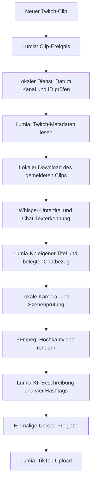

# CNG Clip Dienst

Windows-Hintergrunddienst für **neue Twitch-Clips → Hochkantvideo → Untertitel → KI-Titel → TikTok**, mit Lumia Stream als Ereignisquelle und Upload-Anbindung.

[](https://github.com/Timur18o4/CNG-Clip-Dienst/actions/workflows/tests.yml)

**v0.1.0 · erste öffentliche Testversion.** Die Bildaufteilung und der Chatbezug werden automatisch eingeschätzt. Bei unsicherer Kameraerkennung hält der Dienst den Clip zur Prüfung an. Die Referenzprofile müssen zu den eigenen OBS-Szenen passen.

## Funktionen

- Erkennt neue Twitch-Clips über Lumias `twitch-clip`-Ereignis; prüft beim Verbinden auch gepufferte Lumia-Ereignisse.
- Verarbeitet ausschließlich Clips, deren Twitch-Erstellungsdatum **nach der ersten Dienstaktivierung** liegt. Bekannte IDs und Replays werden ignoriert.
- Lädt genau den gemeldeten öffentlichen Clip. Kein historischer Clip wird ersatzweise verwendet.
- Erstellt lokal zeitgesteuerte Untertitel mit Faster Whisper.
- Liest sichtbare Chatnachrichten mit RapidOCR. Ein Chat-Zitat wird nur aus mehrfach gelesenen Kandidaten ausgewählt; die KI muss einen passenden Untertitelausschnitt als Beleg liefern.
- Erzeugt über Lumias `ai_prompt` einen eigenen Videotitel statt der unveränderten Twitch-Überschrift.
- Unterscheidet große Kamera, Gameplay mit Webcam und Desktop/Reaction mit Webcam anhand von Stichproben. Innerhalb eines Clips sind Layoutwechsel möglich.
- Rendert mit FFmpeg in 1080 × 1920 mit eingebrannten Untertiteln und CNG-PLATTFORM.COM-Branding. Titel, Chatkontext und Untertitel stehen außerhalb des Hauptbilds und der Webcam.
- Erzeugt über Lumia eine TikTok-Beschreibung mit maximal 150 Zeichen und genau vier Hashtags. Der vierte Hashtag entspricht der Clip-Kategorie.
- Veröffentlicht über Lumias `uploadAndPublishVideo`, mit dauerhaft gespeicherter einmaliger Upload-Freigabe gegen blinde Doppelposts.
- Bietet einen lokalen Status, Bildprofile, MP4-Vorschau und eine lokale KI-Vorschau für bereits übergebene Clips.
- Startet optional bei der Windows-Anmeldung über die Aufgabenplanung und wartet automatisch auf Lumia.

## Ablauf



Der Dienst läuft auf dem eigenen PC. Lumia erledigt die Twitch-Metadatenabfrage mit seiner bestehenden Anmeldung, die Text-KI-Aufrufe und den TikTok-Upload. Eine zusätzliche Twitch-App mit Client Secret ist für diesen Ablauf nicht vorgesehen.

## Voraussetzungen

| Bestandteil | Voraussetzung |
|---|---|
| Betriebssystem | Windows 10/11, 64 Bit; Referenzumgebung Windows mit Python 3.12 |
| Python | Python 3.12, erreichbar über die Standardinstallation oder `python.exe` im PATH |
| FFmpeg | Vollständige Installation mit `ffmpeg` und `ffprobe`, beispielsweise `winget install --id Gyan.FFmpeg --exact` |
| Lumia Stream | Getestet mit 9.3.4; lokale REST-/WebSocket-API, Custom Code, `ai_prompt`, Clip-Alarm und TikTok-Aktion erforderlich |
| Lumia-Konten | Eigenes Twitch-Konto, gewünschtes TikTok-Konto und ein KI-Anbieter eingerichtet |
| Speicher/Netz | Platz für Python-Pakete, Modellgewichte, Quelldateien und Exporte; Internet für Plattformzugriffe und erste Modelldownloads |

Die lokale Analyse verwendet standardmäßig die CPU. Python, FFmpeg, Lumia, Modelle und Plattformzugänge sind **nicht** im Programm-ZIP enthalten. Die Installation lädt die Python-Pakete; Whisper und das Bildmodell laden bei Bedarf ihre Gewichte in den normalen Modellcache. KI-Aufrufe über Lumia können Kosten beim dort gewählten Anbieter verursachen.

## Einrichtung

1. Das [Windows-Programm-ZIP aus dem Release](https://github.com/Timur18o4/CNG-Clip-Dienst/releases) entpacken oder das Repository klonen. Einen dauerhaften Ordner wählen, beispielsweise `E:\Scripte\CNG_Clip_Dienst`.
2. Python und vollständiges FFmpeg installieren. Lumia starten, die Konten verbinden und die lokale API aktivieren.
3. `EINRICHTEN.cmd` ausführen. Das erstellt die Python-Umgebung, installiert die Abhängigkeiten und fragt **den eigenen Twitch-Kanal sowie den lokalen Lumia-API-Token** ab. Der Token wird verdeckt eingegeben und mit Windows-DPAPI gespeichert.
4. In Lumia einen Chat-Befehl **`cng-clip-dienst`** anlegen:
   - nur für den Streamer freigeben;
   - „Warteschlange überspringen“ aktivieren;
   - den vollständigen Inhalt von [lumia/cng-clip-dienst.js](lumia/cng-clip-dienst.js) als Code-Aktion einfügen;
   - keine Chat-Antwort ergänzen und die Lumia-Änderungen übernehmen.
5. Den Twitch-Clip-Alarm aktivieren. **„Clips vom Streamer ignorieren“ ausschalten.** Der Alarm benötigt Stream-Modus, sofern er nicht ausdrücklich so eingestellt wurde, diesen zu ignorieren.
6. `STARTEN.cmd` öffnen. Im Status „Lumia prüfen“ aufrufen und die Bildprofile unter „Bildprofile anpassen“ auf die eigenen OBS-Szenen abstimmen.
7. Einen **neu erstellten** Twitch-Clip testen. Die Voreinstellung für neue Installationen lautet **„Nur ich“ / `SELF_ONLY`**. Den tatsächlich vorhandenen privaten Beitrag bei TikTok kontrollieren.
8. Bei gewünschter öffentlicher Veröffentlichung die Sichtbarkeit im Status auf „Öffentlich“ stellen. Sie wird beim Fertigstellen eines Clips festgehalten; bestehende private Beiträge werden dadurch nicht verändert oder erneut hochgeladen.
9. `AUTOSTART AN.cmd` ausführen, wenn der Dienst künftig bei der Windows-Anmeldung selbst starten soll. Lumia muss ebenfalls laufen beziehungsweise automatisch starten.

Weitere Details: [Einrichtung und Fehlerbehebung](docs/SETUP.md), [Konfiguration und Datenordner](docs/CONFIGURATION.md).

## Bedienung

| Datei/Adresse | Zweck |
|---|---|
| `STARTEN.cmd` | Dienst bei Bedarf starten und Status öffnen |
| `STOPPEN.cmd` | Hintergrunddienst beenden |
| `AUTOSTART AN.cmd` | Windows-Auftrag für die eigene Anmeldung einrichten |
| `AUTOSTART AUS.cmd` | Automatischen Start deaktivieren |
| `http://127.0.0.1:39242` | Lokaler Status, Sichtbarkeit, Bildprofile und Video-Vorschau |
| „KI-Vorschau erstellen“ | Lokale neue Gestaltung eines bereits übergebenen Clips; kein erneuter TikTok-Upload |

Der Windows-Auftrag heißt **CNG Clip Dienst**. Er läuft im angemeldeten Benutzerkonto, ohne Administratorrechte und ohne Laufzeitlimit. Bei unerwartetem Fehler sind bis zu zehn Neustartversuche im Minutenabstand vorgesehen. Falls die Aufgabenplanung nicht eingerichtet werden kann, verwendet das Skript den Benutzer-Autostart als Rückfallweg. Es handelt sich um einen Hintergrundprozess in der Benutzersitzung, nicht um einen Systemdienst vor der Anmeldung.

## Daten und Zugriffsschutz

Der Standard-Datenordner ist `%LOCALAPPDATA%\CNGClipDienst`. `installation.json` merkt sich den tatsächlich gewählten Ort. Mit `CNG_CLIP_DATA` kann vor der Einrichtung ein eigener Ort gewählt werden.

- Originale: `clips/<Clip-ID>.mp4`; während des Downloads zunächst `.part`.
- Fertige Videos: `renders/<Clip-ID>.mp4`; lokale Varianten enden auf `-preview.mp4`.
- Untertitelcache: `transcripts/`; Berichte: `reports/`.
- Datenbank: `jobs.sqlite3`; Protokolle: `service.log` und gegebenenfalls `runtime.log`.
- Temporäres Rendering: `cng-scenes-*` im Datenordner, mit weiteren `.cng-render-*`-Ordnern.
- Extrahierte Tonspuren: `cng-transcribe-*` im Windows-Tempordner.

Originale, fertige Videos und Transkript-Caches bleiben gespeichert. Arbeitsordner werden normalerweise entfernt; nach hartem Prozessabbruch können Reste verbleiben. **Es gibt keine automatische Videolöschung.**

Zugangsdaten sind an das Windows-Konto gebunden. Der Twitch-Token bleibt in Lumia. Der Dienst bindet nur an `127.0.0.1`; schreibende Zugriffe benötigen einen lokalen Schlüssel. Die lokale API darf nicht ins Internet weitergeleitet werden. Untertitel und erkannte Chattexte werden für die Titel-/Beschreibungs-KI an den in Lumia konfigurierten Anbieter weitergegeben. Das fertige Video wird über Lumia an TikTok übertragen.

Repository und Release enthalten **keine Kontodaten, Tokens, Datenbanken, privaten Einstellungen, Clips, Modellgewichte oder Browserprofile**. Die mitgelieferten Testdaten sind synthetische Beispiele. Siehe [SECURITY.md](SECURITY.md).

## Grenzen

- Die Kameraprofile sind Referenzwerte für eine 1920×1080-Quelle. Sie werden relativ zur Auflösung skaliert, müssen aber zur Szene passen. Ein Gesicht außerhalb des Profils hält den Clip zur Prüfung an.
- Die Szenenprüfung arbeitet mit höchstens etwa 18 Stichproben, mindestens zwei Sekunden auseinander. Sehr kurze Wechsel können übersehen werden.
- Chatkontext setzt sichtbare, lesbare Nachrichten an den Bildrändern mit erkennbarem Plattformkopf voraus. Nicht sichtbare Nachrichten werden nicht rekonstruiert. Die ausgewählte Chatzeile steht als Kontext im Kopfbereich; sie ist kein laufender Chatverlauf.
- Sprache, Texterkennung, Titel und Antwortbezug können Fehler enthalten. Bei fehlender Chat-Evidenz wird kein Zitat verwendet.
- Der bereits ausgewählte Twitch-Clip wird vollständig verarbeitet, maximal 180 Sekunden. Das Tool sucht nicht selbst nach Highlights in einem kompletten Stream.
- Ereignisse können durch Lumia verzögert eintreffen. Es gibt keinen historischen Twitch-Abruf als Ersatz für fehlende Lumia-Ereignisse.
- „An Lumia übergeben“ bestätigt die Rückkehr der Upload-Aktion, nicht TikToks abschließende Verarbeitung. Ein ungeklärter Upload wird nach der einmaligen Freigabe nicht blind wiederholt.
- Die Standardports 39231 und 39242 sind in dieser Version aufeinander abgestimmt. Abweichende Ports benötigen Anpassungen an Dienst, Lumia-Code und Startskript.
- Lumia, Twitch, TikTok und der öffentliche Clip-Download können ihre Schnittstellen ändern.

Der tatsächliche Prüfstand und die noch nicht mit echten Clips überprüften Fälle stehen in [docs/VALIDATION.md](docs/VALIDATION.md).

## Entwicklung

```powershell
python -m venv .venv
.\.venv\Scripts\python.exe -m pip install -r requirements-test.txt
.\.venv\Scripts\python.exe -m unittest discover -s tests -v
node tests/lumia_contract.cjs
.\.venv\Scripts\python.exe scripts/check_public_tree.py
```

Für die Anwendung selbst wird `requirements.txt` benötigt. Die Tests verwenden keine echten Konten, laden keine alten Clips und führen keine Uploads aus. GitHub Actions prüft die Python- und Lumia-Vertragstests unter Windows.

## Lizenz

**Derzeit ist keine Nutzungslizenz festgelegt.** Das Repository wird öffentlich zur Einsicht bereitgestellt; eine gesonderte Lizenzierung wurde noch nicht entschieden. Abhängigkeiten und Modelle unterliegen ihren jeweiligen Lizenzbedingungen. Siehe auch [GitHubs Hinweise zur Repository-Lizenzierung](https://docs.github.com/en/repositories/managing-your-repositorys-settings-and-features/customizing-your-repository/licensing-a-repository).

## Grundlagen

- [Lumia: WebSocket-Ereignisse](https://dev.lumiastream.com/docs/websockets/listen-to-events)
- [Lumia: Befehle und Laufzeitvariablen](https://dev.lumiastream.com/docs/rest/send-commands)
- [Lumia: Custom Actions und TikTok](https://dev.lumiastream.com/docs/custom-code/custom-actions)
- [Lumia: Variablenfunktionen](https://dev.lumiastream.com/docs/variable-functions)
- [Twitch: Clip-Metadaten](https://dev.twitch.tv/docs/api/reference/#get-clips)
- [yt-dlp: Twitch-Extractor](https://github.com/yt-dlp/yt-dlp/blob/master/yt_dlp/extractor/twitch.py)
- [RapidOCR](https://github.com/RapidAI/RapidOCR)
- [Whisper-Implementierung](https://github.com/SYSTRAN/faster-whisper)
- [Lokales CLIP-Bildmodell](https://huggingface.co/openai/clip-vit-base-patch32)
- [Änderungen](CHANGELOG.md)
